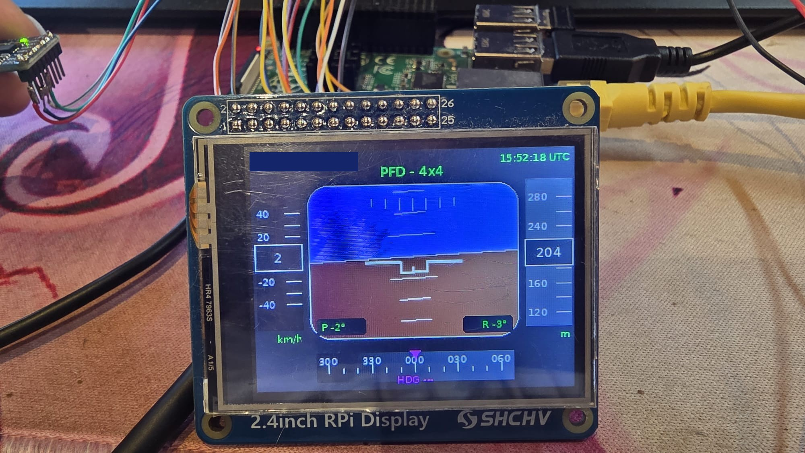
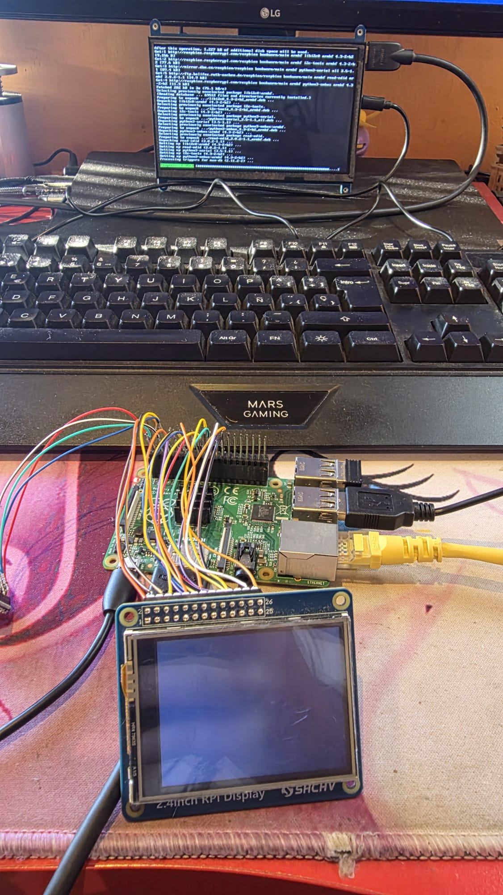
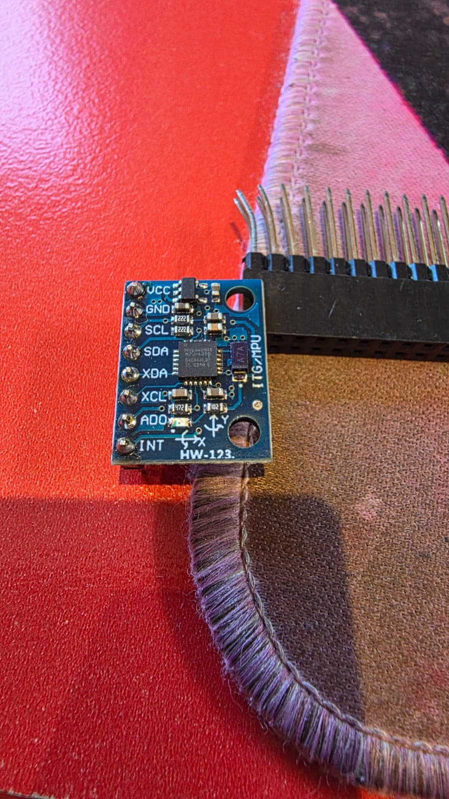
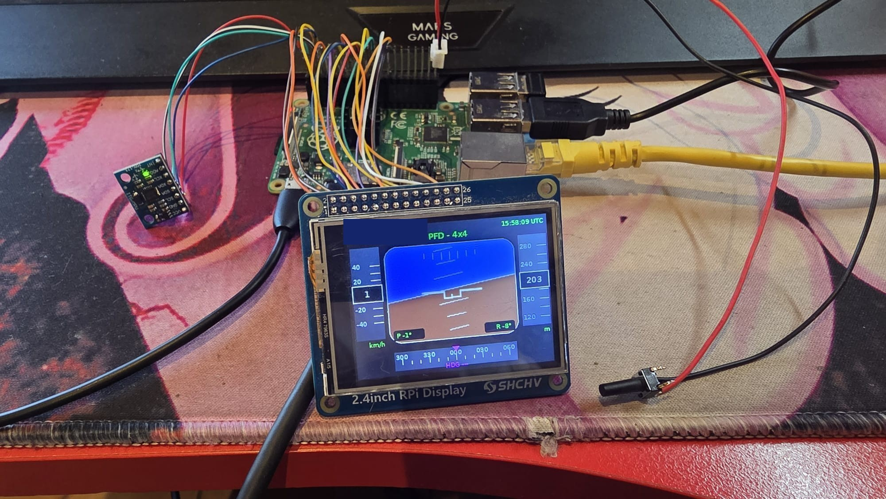

# PFD 4x4

Pequeño indicador de actitud para un vehículo 4x4, con estética de un PFD de avión. Se ejecuta en una Raspberry Pi 1 Model B+ y una TFT SPI de 2,4 pulgadas (320 × 240), con gráficos dibujados en Python y actualizados hasta 24 veces por segundo.



El horizonte artificial se anima con el pitch y el roll del MPU-6050. Las cintas laterales muestran velocidad y altitud GPS, la cinta inferior muestra el curso GPS disponible, y la parte superior presenta posición y hora UTC. Incluye modo de demostración sin sensores.

## Fotografías

| PFD funcionando | Montaje en la Raspberry Pi |
|---|---|
|  |  |

| MPU-6050 | Conjunto instalado |
|---|---|
|  |  |

## Hardware

- Raspberry Pi 1 Model B+ (revisión 1.2; BCM2835/ARMv6, 512 MB).
- Pantalla LCDWiki SHCHV de 2,4 pulgadas, 320 × 240, controlador ILI9341 y digitalizador XPT2046. Se usa el framebuffer `/dev/fb1` que instala el controlador de la pantalla.
- Módulo MPU-6050 HW-123 por I²C.
- Receptor GPS USB que emita mensajes NMEA por puerto serie, preferiblemente con antena exterior. El programa detecta automáticamente `/dev/ttyACM*`, `/dev/ttyUSB*` y `/dev/serial/by-id/*` y usa 9600 baudios por defecto. El modelo exacto del receptor usado no está documentado todavía.
- Pulsador normalmente abierto para poner a cero pitch y roll.

### Conexiones del MPU y el pulsador

| Módulo/señal | Raspberry Pi |
|---|---|
| MPU VCC | 3V3, pin físico 1 |
| MPU GND | GND, pin físico 6 |
| MPU SCL | GPIO3 / SCL1, pin físico 5 |
| MPU SDA | GPIO2 / SDA1, pin físico 3 |
| Pulsador, una patilla | GPIO21 (BCM), pin físico 40 |
| Pulsador, otra patilla | GND, por ejemplo pin físico 39 |

El programa busca el MPU-6050 en `0x68` y `0x69`. XDA, XCL, AD0 e INT del módulo HW-123 quedan sin conectar para este proyecto. La TFT ocupa el conector GPIO de 40 pines mediante el cableado descrito en la guía del fabricante; al cablear una extensión, respeta la orientación y numeración de los pines.

## Sistema operativo

La Raspberry Pi 1 B+ usa ARMv6 de 32 bits. La opción adecuada es **Raspberry Pi OS (Legacy) Lite, 32-bit, basado en Debian Bookworm**. La imagen Lite no instala escritorio. En el momento de redactar esta guía, Raspberry Pi indica que su imagen Legacy de 32 bits es compatible con Pi 1 B+; las imágenes de 64 bits no son para este modelo. [Descargas oficiales de Raspberry Pi OS](https://www.raspberrypi.com/software/operating-systems/) · [Especificaciones de Raspberry Pi B+](https://www.raspberrypi.com/documentation/computers/raspberry-pi.html).

En la Pi usada durante el desarrollo se instaló Raspberry Pi OS Lite y se configuró el controlador de la TFT. **La versión exacta de la imagen instalada no se ha comprobado desde este repositorio**. Para registrarla en el dispositivo:

```sh
cat /etc/os-release
getconf LONG_BIT
```

El segundo comando debería mostrar `32` en una Pi 1 B+.

## Instalación desde cero

1. Graba **Raspberry Pi OS (Legacy) Lite, 32-bit** en la microSD con Raspberry Pi Imager. Configura usuario, contraseña, red y SSH en las opciones avanzadas antes de escribir la tarjeta.
2. Arranca la Pi, conéctate por SSH o por la consola HDMI y actualiza los paquetes:

   ```sh
   sudo apt update
   sudo apt full-upgrade -y
   ```

3. Instala el controlador de la TFT siguiendo la [guía oficial LCDWiki para la pantalla de 2,4 pulgadas](https://www.lcdwiki.com/2.4inch_RPi_Display_For_RPi_3A%2B). El programa espera la pantalla en `/dev/fb1`, a 320 × 240 y en formato RGB565. Si la imagen queda invertida, la herramienta de rotación de LCDWiki permite girarla 180°.
4. Habilita I²C con `sudo raspi-config` → **Interface Options** → **I2C** → **Enable**; reinicia si lo solicita.
5. Instala las dependencias disponibles como paquetes de Raspberry Pi OS:

   ```sh
   sudo apt install -y python3-pil python3-numpy python3-smbus i2c-tools python3-serial python3-rpi.gpio
   ```

6. Clona el repositorio:

   ```sh
   git clone https://github.com/Pony3D/pfd-4x4.git
   cd pfd-4x4
   ```

7. Activa los permisos para usar framebuffer, I²C, GPIO y GPS serie con el usuario actual, cierra la sesión y vuelve a entrar:

   ```sh
   sudo usermod -aG video,gpio,i2c,dialout "$USER"
   ```

8. Conecta la TFT, el MPU y el GPS. Ejecuta la aplicación:

   ```sh
   python3 main.py --fb /dev/fb1
   ```

Para comprobar el bus I²C, detén primero el PFD y ejecuta `sudo i2cdetect -y 1`; debería aparecer `68` o `69`. Para ver los puertos serie encontrados por el sistema:

```sh
ls /dev/ttyACM* /dev/ttyUSB* /dev/serial/by-id/* 2>/dev/null
```

Si la autodetección no encuentra el GPS, indica el puerto manualmente, por ejemplo `python3 main.py --fb /dev/fb1 --gps-port /dev/ttyACM0`. Si el fabricante especifica otra velocidad serie, añade `--gps-baud 38400` con el valor correspondiente.

## Uso

```sh
python3 main.py --fb /dev/fb1              # sensores, refresco nominal de 24 FPS
python3 main.py --fb /dev/fb1 --demo       # datos simulados
python3 main.py --preview pfd.png --demo  # guardar una imagen de vista previa
```

Mantén el vehículo quieto al arrancar para que el MPU estabilice su lectura inicial. En una superficie nivelada, pulsa el botón conectado a GPIO21 para fijar la inclinación actual como cero. El cero dura hasta que se cierra la aplicación. Ctrl+C detiene el programa y limpia la TFT.

El rumbo mostrado procede del curso GPS mientras el vehículo se desplaza; el MPU-6050 no tiene magnetómetro. A velocidad muy baja el GPS no proporciona un curso fiable, por lo que el indicador puede mostrar `HDG ---`. La hora se toma de los mensajes UTC del GPS cuando hay datos válidos; si no, se muestra la hora del sistema.

### Inicio automático opcional

Para usar el equipo sin teclado, habilita **Console Autologin** para el usuario de la Pi en `sudo raspi-config`. Después añade al final de `~/.profile` este bloque, con la ruta correcta al repositorio:

```sh
if [ "$(tty)" = "/dev/tty1" ] && [ -z "$SSH_TTY" ]; then
    cd "$HOME/pfd-4x4"
    python3 main.py --fb /dev/fb1
fi
```

Al arrancar, el PFD ocupa la TFT. Al pulsar Ctrl+C se detiene y vuelve a la consola.

## Estructura

```text
pfd-4x4/
├── assets/       # Fotografías para este README
├── main.py       # Aplicación PFD
└── README.md     # Esta guía
```

## Licencia

Este proyecto se distribuye con la licencia **MIT**. Permite usar, copiar, modificar, publicar y redistribuir el código, siempre que se conserve el aviso de copyright y el texto de la licencia. Consulta [LICENSE](LICENSE) para ver sus condiciones completas.

